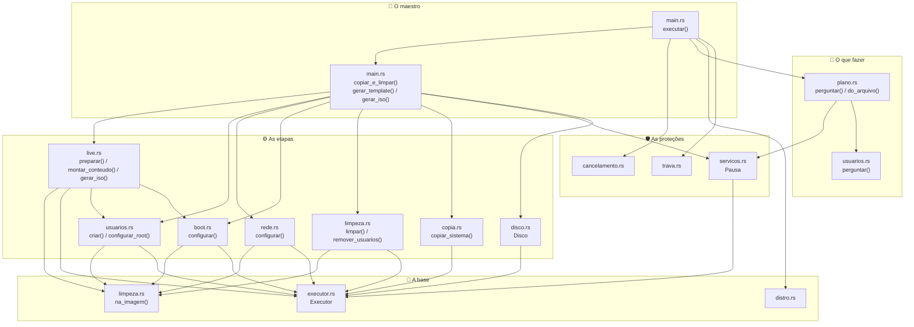

# 🧭 Guia do código do maloki

> **Para quem é este guia:** para quem quer **ler, entender e contribuir** com o
> código, inclusive quem está **aprendendo Rust**. Não precisa saber Rust
> avançado: o projeto usa só o básico (structs, enums, `match`, `Result`, `Vec`),
> e este guia aponta onde cada conceito aparece.
>
> Se você só quer **usar** a ferramenta, o lugar certo é o [README.md](README.md).

---

## Índice

1. [O programa em 30 segundos](#1-o-programa-em-30-segundos)
2. [Mapa dos arquivos](#2-mapa-dos-arquivos)
3. [Por onde começar a ler (a trilha)](#3-por-onde-começar-a-ler-a-trilha)
4. [Quem chama quem](#4-quem-chama-quem)
5. [Uma execução do começo ao fim](#5-uma-execução-do-começo-ao-fim)
6. [Arquivo por arquivo](#6-arquivo-por-arquivo)
7. [Os 6 padrões do projeto](#7-os-6-padrões-do-projeto)
8. [Conceitos de Rust e onde ver cada um](#8-conceitos-de-rust-e-onde-ver-cada-um)
9. [Como os testes funcionam](#9-como-os-testes-funcionam)
10. [Receitas: "quero mudar X"](#10-receitas-quero-mudar-x)
11. [Por que o código é assim (bugs que já aconteceram)](#11-por-que-o-código-é-assim-bugs-que-já-aconteceram)
12. [Checklist antes de abrir o Pull Request](#12-checklist-antes-de-abrir-o-pull-request)
13. [Glossário](#13-glossário)

---

## 1. O programa em 30 segundos

O `maloki` é um **maestro**: ele quase não faz nada sozinho. Ele
**manda outros programas do Linux trabalharem**, na ordem certa, e cuida para
que nada dê errado no caminho.

```
 ┌──────────────┐   ┌───────────┐   ┌────────┐   ┌─────────┐   ┌──────────┐   ┌──────────┐
 │ cria o disco │ → │ particiona│ → │ copia  │ → │ limpa   │ → │ ajusta   │ → │ troca os │
 │ (qemu-img,   │   │ e formata │   │ (rsync)│   │ dados   │   │ boot e   │   │ usuários │
 │  losetup)    │   │ (sfdisk,  │   │        │   │ pessoais│   │ rede     │   │ (useradd)│
 │              │   │  mkfs)    │   │        │   │         │   │ (grub...)│   │          │
 └──────────────┘   └───────────┘   └────────┘   └─────────┘   └──────────┘   └──────────┘
```

No fim, o mesmo sistema copiado e limpo vira **um de dois arquivos**:

```
                                       ┌─▶ template:  ajusta boot → troca usuários → .qcow2 (qemu-img)
 cria disco → copia → limpa → chroot ──┤
                                       └─▶ ISO:       sessão live + Calamares → squashfs → .iso (grub-mkrescue)
```

O "segredo" é o **disco *loop*** do kernel: o comando `losetup` faz um arquivo
comum (`.raw`) aparecer como se fosse um disco de verdade (`/dev/loop0`). A partir
daí, dá para particionar, formatar e
montar esse "disco" com as ferramentas normais do Linux.

---

## 2. Mapa dos arquivos

```
maloki/
├── Cargo.toml              dependências (dialoguer, ctrlc, serde, toml)
├── README.md               como USAR a ferramenta
├── GUIA-DO-CODIGO.md       você está aqui
├── exemplo-plano.toml      exemplo do modo automático (--plano) para um template
├── exemplo-iso.toml        exemplo do modo automático para uma ISO
├── assets/logo.png         logo padrão do instalador (quando a distro não tem um)
│
├── src/
│   │  ─── o maestro ───
│   ├── main.rs             a sequência inteira: verificações → plano → 9 passos (template OU ISO)
│   │
│   │  ─── a base (todo mundo usa) ───
│   ├── executor.rs         roda comandos e mexe em arquivos (ou só MOSTRA, na simulação)
│   ├── distro.rs           qual Linux é este? (família Fedora ou Debian)
│   │
│   │  ─── o que fazer ───
│   ├── plano.rs            as escolhas da pessoa: pelos menus OU por um arquivo .toml
│   ├── usuarios.rs         menu de usuários e os comandos que criam usuários
│   │
│   │  ─── as etapas ───
│   ├── disco.rs            cria/conecta o .qcow2, particiona, formata, monta, desmonta
│   ├── copia.rs            copia o sistema (rsync); calcula tamanho e espaço livre
│   ├── limpeza.rs          apaga dados pessoais e segredos; a TRAVA de segurança
│   ├── boot.rs             faz a imagem ligar (fstab, GRUB, initramfs, BIOS/UEFI)
│   ├── rede.rs             troca IP fixo da máquina original por DHCP
│   ├── live.rs             ISO: sessão live, Calamares, squashfs, grub-mkrescue
│   │
│   │  ─── as proteções ───
│   ├── cancelamento.rs     Ctrl+C seguro
│   ├── trava.rs            impede duas cópias do programa ao mesmo tempo
│   └── servicos.rs         pausa bancos de dados durante a cópia
│
└── tests/e2e/              testes REAIS em VMs descartáveis
    ├── rodar.sh            o roteiro: liga VMs, clona, liga as imagens, confere
    ├── robo.py             "digita" nos menus como uma pessoa
    ├── conferir.sh         roda DENTRO da VM clonada e confere ~23 itens
    └── iso/                os testes da ISO
        ├── serial.py                  dirige a sessão live pela porta serial
        ├── checar-live.sh             confere a sessão live e o Calamares
        ├── instalar-como-calamares.sh instala no disco como o Calamares faria
        └── conferir-instalado.sh      confere o sistema instalado, via SSH
```

Os testes rápidos (`cargo test`) ficam **no fim de cada arquivo `.rs`**, dentro
de um bloco `#[cfg(test)] mod testes { ... }`. É o costume em Rust.

---

## 3. Por onde começar a ler (a trilha)

Não leia em ordem alfabética! Siga esta trilha: cada arquivo prepara o próximo.

| # | Arquivo | O que ler | Por que nesta ordem |
|---|---|---|---|
| 1 | [`main.rs`](src/main.rs) | Só `executar()`, `copiar_e_limpar()`, `gerar_template()` e `gerar_iso()` | Dá a **visão do todo**: a lista de passos. Não entre nos detalhes ainda. |
| 2 | [`executor.rs`](src/executor.rs) | Inteiro (é curto) | **Todo** comando do programa passa por aqui. Entendendo isso, você entende o modo `--simular`. |
| 3 | [`distro.rs`](src/distro.rs) | Inteiro | Arquivo simples, bom para "aquecer": um `enum`, um `match` e leitura de arquivo. |
| 4 | [`disco.rs`](src/disco.rs) | Inteiro, com atenção ao `impl Drop` | Mostra o padrão mais importante do projeto: **limpar sozinho quando algo dá errado**. |
| 5 | [`copia.rs`](src/copia.rs) | `copiar_sistema()` e a lista `EXCLUIR` | Simples e muito importante: é aqui que se decide o que **não** vai para a imagem. |
| 6 | [`limpeza.rs`](src/limpeza.rs) | `na_imagem()` primeiro, depois `limpar()` | `na_imagem()` é a **trava de segurança** que protege o seu sistema de verdade. |
| 7 | [`usuarios.rs`](src/usuarios.rs) | `criar()` e `perguntar()` | Menus com `dialoguer` e comandos com `-R` (rodar "dentro" da imagem). |
| 8 | [`plano.rs`](src/plano.rs) | `Plano`, depois `do_arquivo()` | Como duas entradas diferentes (menus e `.toml`) viram o **mesmo** struct. |
| 9 | [`boot.rs`](src/boot.rs) | `configurar()` → `ajustar_arquivos()` → o resto | O arquivo **mais difícil**. Deixe para quando estiver confortável. |
| 10 | [`rede.rs`](src/rede.rs) | `configurar()` | Mesma ideia do boot, para a rede. |
| 10½ | [`live.rs`](src/live.rs) | O comentário do topo, depois `preparar()` e o `POS_INSTALACAO` | A ISO. Reaproveita quase tudo dos arquivos anteriores. |
| 11 | [`trava.rs`](src/trava.rs), [`servicos.rs`](src/servicos.rs), [`cancelamento.rs`](src/cancelamento.rs) | Inteiros (são curtos) | As proteções. Repare que `trava` e `servicos` usam o mesmo truque do `Drop`. |
| 12 | [`tests/e2e/`](tests/e2e) | `rodar.sh` → `testar_distro()` | Como provamos que tudo funciona de verdade. |

> 💡 **Dica de leitura:** abra o arquivo, leia **só os comentários** primeiro
> (as linhas com `//` e `///`). Eles contam a história. Depois volte e leia o código.

---

## 4. Quem chama quem



**Em palavras:**

| Arquivo | Chama | É chamado por |
|---|---|---|
| `main.rs` | quase todos | ninguém (é o começo) |
| `plano.rs` | `usuarios`, `servicos`, `copia` (para estimar o tamanho) | `main` |
| `disco.rs` | `executor` | `main::copiar_e_limpar` |
| `copia.rs` | `executor` | `main`, `plano` |
| `limpeza.rs` | `executor` | `main`, e o `na_imagem()` dele é usado por `boot`, `rede`, `usuarios` |
| `boot.rs` | `executor`, `limpeza::na_imagem`, `distro::Familia` | `main` |
| `rede.rs` | `executor`, `limpeza::na_imagem` | `main` |
| `live.rs` | `executor`, `limpeza::na_imagem`, `boot`, `usuarios::definir_senha` | `main::gerar_iso` |
| `usuarios.rs` | `executor`, `limpeza::na_imagem` | `main`, `plano` |
| `servicos.rs` | `executor` | `main`, `plano` |
| `trava.rs`, `cancelamento.rs` | nada do projeto | `main` |
| `executor.rs`, `distro.rs` | nada do projeto | todo mundo |

> 🔑 **Regra de ouro:** os arquivos de etapa **nunca** rodam um comando direto
> (`std::process::Command`). Eles sempre pedem ao `Executor`. É isso que faz o
> `--simular` funcionar em todo o programa de uma vez.

---

## 5. Uma execução do começo ao fim

O que acontece quando alguém roda `sudo maloki`:

```
main()
 └─ ler_opcoes()                    --simular? --plano arquivo? --ajuda?
 └─ executar()
     ├─ eh_root()                   precisa ser root (menos na simulação)
     ├─ trava::pegar()              ninguém mais pode rodar até acabarmos
     ├─ distro::detectar()          lê /etc/os-release → Fedora ou Debian?
     ├─ existe_programa() × N       qemu-img, rsync, sfdisk... estão instalados?
     ├─ plano::perguntar()          menus (template ou ISO?)...
     │    OU plano::do_arquivo()    ...ou o arquivo .toml (tipo = "template" | "iso")
     ├─ template: boot::detectar_modos()     tem GRUB para BIOS? E para UEFI?
     │  ISO:      live::o_que_falta()        Calamares, initramfs live, tela de login...
     ├─ copia::espaco_livre()       cabe? (senão: erro ANTES de começar)
     ├─ mostrar_resumo() + "Começar?"
     ├─ cancelamento::instalar()    a partir daqui, Ctrl+C é seguro
     │
     ├─ copiar_e_limpar()           ── igual para os dois tipos ──
     │   ├─ [1] qemu-img create                       cria o disco de trabalho (.raw)
     │   ├─     Disco::conectar()                     losetup --find --partscan
     │   ├─ [2] disco.particionar_e_formatar()        sfdisk + mkfs.vfat + mkfs.ext4
     │   ├─     disco.montar() × 3                    raiz, /boot e /boot/efi em /mnt/maloki-PID
     │   ├─ [3] servicos::pausar()                    para bancos de dados (se pedido)
     │   │      copia::copiar_sistema()               rsync / → disco (sem o .raw, o .tmp...)
     │   │      (fim do bloco: Drop da Pausa religa os bancos)
     │   ├─ [4] limpeza::limpar()                     apaga segredos e identidade
     │   └─ [5] disco.montar() × 5                    /dev, /dev/pts, /proc, /sys, /run
     │
     ├─ gerar_template()            ── tipo = "template" ──
     │   ├─ [6] boot::configurar()                    fstab, GRUB, initramfs (via chroot)
     │   │      rede::configurar()                    IP fixo → DHCP
     │   ├─ [7] limpeza::remover_usuarios()           userdel + regras de sudo
     │   │      usuarios::configurar_root()           bloqueia ou troca a senha do root
     │   │      usuarios::criar()                     useradd + senha (usermod -p) + chave SSH
     │   │      disco.finalizar()                     desmonta, grava o cache, e2fsck -n, solta o loop
     │   ├─ [8] qemu-img convert .raw → ARQUIVO.tmp   (-c = compactada, zstd ou zlib)
     │   └─ [9] qemu-img check                        confere o .tmp
     │
     ├─ gerar_iso()                 ── tipo = "iso" ──
     │   ├─ [6] remover_usuarios + root bloqueado + rede DHCP
     │   │      live::preparar()                      liveuser, login automático, Calamares,
     │   │                                            pos-instalacao, initramfs live
     │   ├─ [7] disco.desmontar_ate(3)                tira /dev, /proc... do chroot
     │   │      live::montar_conteudo()               kernel + initrd + menu + mksquashfs
     │   │      disco.finalizar()
     │   ├─ [8] live::gerar_iso()                     grub-mkrescue → ARQUIVO.tmp
     │   └─ [9] live::conferir_iso()                  xorriso confere o que tem dentro
     │
     ├─ exec.renomear(ARQUIVO.tmp → ARQUIVO)          só agora a imagem antiga é trocada
     ├─ chown                                         o arquivo passa a ser do seu usuário
     └─ mensagens finais + avisos de chaves privadas
```

**E se der erro no meio?** Qualquer `?` faz a função voltar com o erro. Quando
`gerar_template()`/`gerar_iso()` volta, a variável `disco` deixa de existir, e o
Rust chama o `Drop` dela **automaticamente**: desmonta tudo e solta o
`/dev/loop0`. Depois, `executar()` apaga o `.tmp` pela metade. A imagem antiga
com o nome final **não é tocada**: o `.tmp` só troca de nome no fim. Ver [padrão 3](#padrão-3-o-drop-limpa-sozinho-raii).

---

## 6. Arquivo por arquivo

### `main.rs`: o maestro
- **Faz:** lê as opções, faz as verificações iniciais e chama as etapas na ordem.
- **Funções:** `main`, `ler_opcoes`, `executar`, `copiar_e_limpar` (passos 1 a 5),
  `gerar_template` + `criar_imagem`, `gerar_iso`, `mostrar_resumo`, `passo`,
  `eh_root`, `existe_programa`, `avisar_ou_parar`.
- **Repare em:** `passo()` confere o Ctrl+C **antes** de cada etapa. A pausa dos
  bancos fica dentro de um bloco `{ }`: quando o bloco acaba, eles religam. O
  resultado é sempre gravado em `ARQUIVO.tmp` e só troca de nome no fim (ver [bug 13](#11-por-que-o-código-é-assim-bugs-que-já-aconteceram)).
- **Testes (3):** opções da linha de comando; o **pipeline inteiro em simulação**
  para as 2 famílias × 3 combinações de BIOS/UEFI; e o da ISO nas 2 famílias.

### `executor.rs`: a peça central
- **Faz:** roda comandos e mexe em arquivos. Com `simular: true`, só **mostra**.
- **Métodos:** `rodar`, `rodar_aceitando` (aceita códigos de saída extras, como o 24 do rsync),
  `rodar_com_entrada` (manda texto para o comando, como o roteiro de partições para o `sfdisk`),
  `rodar_com_segredo` (esconde um segredo, como o hash da senha, na tela),
  `capturar` (devolve o que o comando escreveu, como o UUID do `blkid`), `escrever`,
  `escrever_bytes` (o logo do instalador), `renomear`, `apagar`,
  `esvaziar_pasta`, `editar` (lê → transforma → grava).
- **Repare em:** `apagar()` usa `symlink_metadata` para **nunca seguir links**:
  apagar um link para `/` apaga só o link.
- **Testes (11):** comandos reais (`true`, `false`, `sh -c "exit 24"`), arquivos reais, links.

### `distro.rs`: qual Linux é este?
- **Faz:** lê `/etc/os-release` e decide a **família**: `Familia::Fedora` ou `Familia::Debian`.
- **Funções:** `detectar` (lê o arquivo), `detectar_de_texto` (a lógica, testável),
  `Familia::grupo_admin` (`wheel` ou `sudo`), `Familia::ferramentas`,
  `Familia::ferramentas_iso` e `Familia::pacotes_iso` (o comando que instala tudo o que a ISO precisa).
- **Testes (9):** os os-release de Fedora, Rocky, Alma, RHEL, Ubuntu, Mint, Pop!_OS, Debian, Arch...

### `plano.rs`: o que a pessoa quer
- **Faz:** monta o `struct Plano` a partir dos **menus** (`perguntar`) ou de um
  **arquivo `.toml`** (`do_arquivo`). O resto do programa só enxerga o `Plano`.
- **Os dois `enum`:** `Tipo` (`Template` ou `Iso`) e `Compressao` (`Zstd`, `Zlib` ou `Xz`).
  Com `#[serde(rename_all = "lowercase")]`, o `.toml` escreve `tipo = "iso"`.
- **`Ambiente`:** o que o plano precisa saber do computador (tamanho do sistema,
  pasta atual, versão do QEMU, `/etc/passwd`, `/etc/group`). Os testes inventam um.
- **`resolver_caminho`:** transforma o nome digitado no caminho **real** (sem `..`
  nem links); ver [bug 14](#11-por-que-o-código-é-assim-bugs-que-já-aconteceram).
- **Repare em:** `#[derive(Deserialize)]` faz a crate `serde` ler o `.toml` direto
  para dentro dos structs. `#[serde(deny_unknown_fields)]` transforma erro de
  digitação (`hostnme`) em erro de verdade.
- **Testes (15):** arquivo completo, mínimo, 11 tipos de erro com a mensagem certa,
  ISO, compressão, caminhos com `..` e links, nomes de conta do sistema, e os
  próprios `exemplo-plano.toml` e `exemplo-iso.toml` (para nunca quebrarem sem ninguém ver).

### `usuarios.rs`: menus e criação de usuários
- **Faz:** pergunta os usuários (nome, senha, sudo, chave SSH) e cria-os **dentro
  da imagem** com `useradd -R raiz` (o `-R` faz o comando editar o `/etc/passwd` da imagem).
- **Funções:** `perguntar`, `validar_nome`, `nome_disponivel` (recusa `gdm`,
  `docker`... que fariam o `useradd` falhar só no fim), `ler_chave` (aceita a chave
  colada ou o caminho do `.pub`, e recusa chave **privada**), `criar`, `configurar_root`, `definir_senha`.
- **Testes (8):** inclui um que testa **todos os 16 mil nomes** de 1 e 2 caracteres.

### `disco.rs`: o disco virtual
- **Faz:** liga um arquivo `.raw` a um `/dev/loopN`, cria 4 partições, formata, monta e desmonta.
  (No fim, o `main.rs` transforma o `.raw` no `.qcow2` com `qemu-img convert`.)
- **As 4 partições:** `1` = *BIOS boot* (1 MB, o GRUB de BIOS mora aqui),
  `2` = EFI (600 MB, FAT32), `3` = `/boot` (1 GB, ext4), `4` = raiz (o resto, ext4).
  O `/boot` fica no começo do disco de propósito: ver [bug 8](#11-por-que-o-código-é-assim-bugs-que-já-aconteceram).
- **Repare em:** `finalizar()` (desmonta, confere com `e2fsck` e só então desconecta);
  `desmontar_ate(n)` (a ISO tira só o chroot antes do `mksquashfs`);
  `encerrar_processos_na_imagem()` (acha processos pelo `/proc/<pid>/root`);
  `impl Drop for Disco`; `esperar_conexao()` e `esperar_particoes()`
  (o kernel demora a deixar o disco pronto, ver [bug 4](#11-por-que-o-código-é-assim-bugs-que-já-aconteceram)).
- **Testes (2):** inclui o `sfdisk` **de verdade** num arquivo comum, conferindo os
  tipos de partição pelo **nome** que o próprio `sfdisk` dá a eles.

### `copia.rs`: a cópia
- **Faz:** monta os argumentos do `rsync` e copia `/` para a imagem.
- **O coração dele:** a lista `EXCLUIR`, com o que **não** vai (`/home/*`, `/proc/*`, caches...).
  Cada padrão começa com `/` para valer só a partir da raiz.
- **`nao_copiar`:** os arquivos que o próprio maloki está criando (`.raw`, `.tmp`,
  `.conteudo`). `escapar_padrao()` protege nomes com `*`, `?` ou `[`.
- **Também:** `estimar_tamanho` (via `du`, somando **tudo** o que está na raiz menos
  a lista `RAIZ_FORA`, que um teste confere contra a `EXCLUIR`), `espaco_livre`
  (via `df`), `espaco_necessario` (diferente para template e ISO).
- **Testes (9):** roda o **`rsync` de verdade** numa "máquina falsa" e confere arquivo por arquivo.

### `limpeza.rs`: dados pessoais e a trava de segurança
- **Faz:** apaga identidade (`machine-id`, chaves SSH do servidor) e segredos
  (Wi-Fi, VPN, logs, e-mails...); remove os usuários; lista chaves privadas TLS.
- **⭐ `na_imagem(raiz, "etc/passwd")`:** monta o caminho de um arquivo **dentro
  da imagem**. Se a raiz não for `/mnt/maloki-*` ou o caminho tiver `..`,
  o programa **para na hora** (`panic!`). Toda remoção do projeto passa por aqui.
- **Listas fáceis de mexer:** `ARQUIVOS`, `PASTAS`, `PASTAS_COM_CHAVES`.
- **Também:** o módulo `apoio`, com as ferramentas dos testes de **todos** os arquivos.
- **Testes (19):** uma "máquina suja" falsa (Wi-Fi, VPN, digitais, autologin...) é limpa e conferida item a item.

### `boot.rs`: fazer a imagem ligar (o mais difícil)
- **O problema:** o sistema original sabe ligar **no seu PC**: ele procura o seu disco
  pelo UUID, destrava o LUKS, monta o btrfs... nada disso existe na VM.
- **`configurar()`** chama `ajustar_arquivos()`, que mexe só em arquivos e é
  testável sem root. Depois roda os comandos via `chroot`:

  | | Família Fedora | Família Debian |
  |---|---|---|
  | initramfs (com drivers de VM) | `dracut --no-hostonly` | `update-initramfs` |
  | GRUB para BIOS | `grub2-install --target=i386-pc` | `grub-install --target=i386-pc` |
  | GRUB para UEFI | atalho `grub.cfg` na partição EFI (`preparar_efi_fedora`) | `grub-install --removable` |
  | menu de boot | `grub2-mkconfig` | `update-grub` |
  | chaves SSH no 1º boot | o próprio sistema recria | serviço `gerar-chaves-ssh` (nosso) |

- **Funções de texto (puras, fáceis de testar):** `nova_cmdline` (tira `rd.luks`,
  `rootflags`, `resume`... e aponta para o disco novo), `ajustar_default_grub`,
  `ajustar_bls` + `sem_prefixo_boot` (o caminho do kernel fica relativo ao `/boot` separado), `fstab`.
- **Testes (26):** inclui um **fuzz com 100 mil linhas de boot aleatórias**.

### `rede.rs`: IP fixo vira DHCP
- **Faz:** apaga as configurações de rede da máquina original e deixa uma regra
  "DHCP em qualquer placa com fio", na ferramenta que o sistema usa:
  NetworkManager (`NM_DHCP`), netplan (`NETPLAN_DHCP`) ou systemd-networkd (`NETWORKD_DHCP`).
- **Testes (8):** usa o netplan **de verdade** da VM `debian` do laboratório (IP fixo amarrado ao MAC).

### `live.rs`: a ISO instalável
- **Como uma ISO live funciona:** o GRUB da ISO liga o kernel com um initramfs
  "live"; ele acha a ISO, monta o **squashfs** (o sistema compactado) e põe uma
  camada gravável **na memória** por cima (*overlay*). Nada vai para o disco até
  alguém instalar.

  | | Família Fedora | Família Debian |
  |---|---|---|
  | initramfs live | `dracut --add dmsquash-live` (pacote `dracut-live`) | `mkinitramfs` com o `live-boot` |
  | squashfs na ISO | `/LiveOS/squashfs.img` | `/live/filesystem.squashfs` |
  | onde fica na sessão live | `/run/initramfs/live/...` | `/run/live/medium/...` |
  | parâmetros de boot | `root=live:CDLABEL=MALOKI_FEDORA rd.live.image ...` | `boot=live` |
  | GRUB UEFI no sistema instalado | copia o shim + grub **assinados** (guardados em `/usr/lib/maloki/efi`) | `grub-install` |

- **`preparar()`:** fstab vazio, usuário `liveuser` (senha `live`, sudo sem senha,
  regra do polkit), login automático (GDM, SDDM ou LightDM), atalho "Instalar o
  sistema", toda a configuração do Calamares em `/etc/calamares` (`SETTINGS` e
  `modulos_calamares()`), o logo (o da distro ou `assets/logo.png`) e o initramfs live.
- **`POS_INSTALACAO`:** o script que o **Calamares** roda dentro do sistema instalado
  (módulo `shellprocess@maloki`). Ele desfaz tudo o que era só da sessão live,
  refaz o initramfs (`kernel-install` / `update-initramfs`) e instala o GRUB em
  BIOS ou UEFI. É shell porque roda **sem o maloki**, no computador de quem instala.
- **`PastaConteudo`:** a pasta com os arquivos da ISO; o `Drop` dela a apaga no fim
  (padrão 3). Ela é criada com `create_dir`, que falha se a pasta já existir:
  nunca apagamos uma pasta que não fomos nós que criamos.
- **Testes (11):** rótulo do volume, versões de kernel (`6.10` > `6.9`), autologin do
  GDM, menu do GRUB, argumentos do `mksquashfs`, a configuração do Calamares passa
  por um **leitor de YAML de verdade** (o do Python), e o script de pós-instalação
  passa pelo `sh -n` (confere a sintaxe sem rodar).

### `servicos.rs`, `trava.rs`, `cancelamento.rs`: as proteções
- **`servicos`:** `pausar()` para os bancos de dados e devolve uma `Pausa`; o `Drop` dela religa.
- **`trava`:** cria `/run/maloki.lock` com o PID; `create_new` garante que só um consegue.
  Trava "velha" (de um processo que já morreu) é ignorada.
- **`cancelamento`:** troca o comportamento do Ctrl+C: em vez de matar o programa,
  só **levanta uma bandeira** (`AtomicBool`), que o `passo()` confere.

---

## 7. Os 6 padrões do projeto

Entendendo estes 6 padrões, você entende 90% do código.

### Padrão 1: tudo passa pelo `Executor`
```rust
exec.rodar("mkfs.ext4", &["-F", "-q", "-L", "raiz", &particao])?;
```
**Por quê:** um único lugar decide se roda de verdade ou só mostra (`--simular`).
Também é o que imprime cada comando na tela, e isso ensina quem está olhando.

### Padrão 2: `na_imagem()` antes de mexer em qualquer arquivo
```rust
exec.apagar(&na_imagem(raiz, "etc/krb5.keytab"))?;   // ✅
exec.apagar(&format!("{}/etc/krb5.keytab", raiz))?;  // ❌ nunca faça isso
```
**Por quê:** um bug que fizesse `raiz` virar `""` apagaria o `/etc/krb5.keytab` **do
seu computador**. Com `na_imagem`, o programa para antes. Há 7 testes que tentam
"escapar" da trava.

### Padrão 3: o `Drop` limpa sozinho (RAII)
```rust
impl Drop for Disco {
    fn drop(&mut self) {
        self.desmontar_tudo();
        self.soltar(); // losetup --detach
    }
}
```
**Por quê:** o Rust chama o `drop` **sempre** que o valor deixa de existir: no fim
normal, num `?` com erro ou num `panic!`. Não tem como "esquecer de limpar".
**Onde aparece:** `Disco` (desmonta), `Pausa` (religa os bancos), `Trava` (apaga o
arquivo de trava), `PastaConteudo` (apaga os arquivos da ISO), `PastaTeste` (apaga
a pasta temporária do teste).
O nome técnico é **RAII**.

### Padrão 4: separar a lógica pura da parte que mexe no sistema
```rust
pub fn detectar() -> Resultado<Distro> {             // mexe no sistema (lê arquivo)
    let texto = fs::read_to_string("/etc/os-release")?;
    detectar_de_texto(&texto)
}
pub fn detectar_de_texto(texto: &str) -> Resultado<Distro> { ... }  // pura: só texto
```
**Por quê:** a função pura dá para testar com **qualquer** os-release (Ubuntu,
Arch...) sem instalar nada. Mesma ideia em `nova_cmdline`, `ajustar_bls`,
`argumentos_rsync`, `montar_do_arquivo`, `usuarios_humanos`...

### Padrão 5: `Resultado<T>` e o `?`
```rust
pub type Resultado<T> = Result<T, Box<dyn std::error::Error>>;

fn criar_imagem(...) -> Resultado<Vec<String>> {
    exec.rodar("qemu-img", &[...])?;   // deu erro? volta com ele AGORA
```
**Por quê:** cada passo depende do anterior. O `?` interrompe tudo no primeiro
erro, e (padrão 3) o `Drop` limpa. Mensagens de erro são em português, dizendo **o que fazer**.

### Padrão 6: testes com uma "máquina falsa"
```rust
let raiz = raiz_de_teste();                       // pasta temporária nova
criar(&raiz, "etc/ssh/ssh_host_rsa_key", "x");    // "suja" a máquina
limpar(&DE_VERDADE, &raiz, "template").unwrap();  // roda o código DE VERDADE
assert!(!existe(&raiz, "etc/ssh/ssh_host_rsa_key"));
```
**Por quê:** testa o código real, com arquivos reais, sem root e sem risco. As
ferramentas estão em `limpeza::apoio` e a pasta se apaga sozinha no fim (padrão 3).

---

## 8. Conceitos de Rust e onde ver cada um

| Conceito | Onde ver um bom exemplo |
|---|---|
| `struct` e `impl` | `Disco` em `disco.rs` |
| `enum` + `match` (o compilador obriga a tratar todos os casos) | `Familia` em `distro.rs` |
| `Option` (`Some`/`None`) | `chave_ssh: Option<String>` em `usuarios.rs` |
| `Result` e o operador `?` | qualquer função que devolve `Resultado` |
| `let ... else` | `let Some(posicao) = escolha else { ... }` em `usuarios.rs` |
| `if let` / `while let` | `while let Some(pasta) = self.montagens.pop()` em `disco.rs` |
| Closures (`\|x\| ...`) | `exec.editar(caminho, \|texto\| ajustar_bls(texto, &uuid))` em `boot.rs` |
| Iteradores (`map`, `filter`, `any`, `collect`) | `limpar_parametros` em `boot.rs` |
| Traits: `Drop` | `disco.rs`, `servicos.rs`, `trava.rs` |
| Traits: `Deref`, `Display` | `PastaTeste` em `limpeza.rs` |
| `#[derive(...)]` | `Clone, Copy` no `Executor`; `Deserialize` no `plano.rs` |
| `enum` lido de um arquivo (`#[serde(rename_all)]`) | `Tipo` e `Compressao` em `plano.rs` |
| Atualização de struct (`..outro`) | `Plano { tipo: Tipo::Iso, ..plano_de_teste(true) }` no teste do `main.rs` |
| `include_bytes!` / `include_str!` (arquivo dentro do programa) | `LOGO_PADRAO` em `live.rs`; `exemplo-plano.toml` no teste do `plano.rs` |
| String "crua" (`r#"..."#`, sem escapar aspas e barras) | `POS_INSTALACAO` em `live.rs` |
| `static` + `AtomicBool` | `cancelamento.rs` |
| Constantes de texto grandes (`const X: &str = "..."`) | `NM_DHCP` em `rede.rs` |
| `impl Fn(&str) -> String` (receber uma função) | `Executor::editar` |
| Módulos (`mod`) e `pub` | o topo do `main.rs` |
| `#[cfg(test)]` e `#[test]` | o fim de qualquer arquivo |
| `#[should_panic]` | os testes da trava em `limpeza.rs` |
| Apelido de tipo (`type`) | `Resultado<T>` em `main.rs` |
| `use ... as ...` (renomear um import) | o módulo de testes de `usuarios.rs` |

---

## 9. Como os testes funcionam

Existem **dois níveis**:

### Nível 1: `cargo test` (rápido, 100+ testes, ~2 segundos, sem root)

```bash
cargo test                       # todos
cargo test boot                  # só os que têm "boot" no nome
cargo test -- --nocapture        # mostra os println! dos testes
```

Cada arquivo testa a si mesmo, no fim dele. Os tipos de teste:

| Tipo | Exemplo |
|---|---|
| Lógica pura | `nova_cmdline("NOVO", "root=... rd.luks.uuid=...")` deve dar `"root=UUID=NOVO ro ..."` |
| Máquina falsa (padrão 6) | `limpa_tudo_que_e_pessoal` em `limpeza.rs` |
| Programa de verdade | o `rsync` em `copia.rs`, o `sfdisk` em `disco.rs` |
| Fuzz (milhares de entradas) | `fuzz_100_mil_linhas_de_boot` em `boot.rs` |
| Simulação do todo | `pipeline_completo_em_simulacao` e `pipeline_da_iso_em_simulacao` em `main.rs` |
| Validador externo | a configuração do Calamares no `yaml` do Python; o script de pós-instalação no `sh -n` |
| Trava de segurança | os `#[should_panic]` em `limpeza.rs` |

### Nível 2: `tests/e2e/rodar.sh` (real, algumas horas, sem root no seu PC)

```
                  seu computador                          VM descartável (2 GB)
                  ──────────────                          ─────────────────────
rodar.sh ──liga──────────────────────────────────▶  "original": Rocky/Debian/Fedora
                                                     com IP fixo, VPN, sudo, chave TLS
         ──copia o binário + roda o maloki─▶  (pelos menus com o robo.py,
                                                        ou com --plano)
         ◀──────────────────── copia a imagem ──────  template-X.qcow2
desliga a original

liga a imagem em BIOS ──┐
liga a imagem em UEFI ──┼──▶ conferir.sh roda DENTRO dela via SSH:
liga com Secure Boot ───┘    hostname, usuários, sudo, machine-id novo, rede DHCP,
                             VPN apagada, sem serviços com falha, SELinux... (~23 itens)
```

E para a **ISO**:

```
rodar.sh ──liga──▶ "original" + Calamares, live-boot/dracut-live, LightDM
         ──roda o maloki com tipo = "iso"──▶ maloki-X.iso
liga a ISO (BIOS, e depois UEFI) com um disco vazio e um "CD de testes":
   serial.py escolhe no GRUB a opção "console serial" e entra como liveuser
   checar-live.sh            a sessão live, o login automático, e o Calamares
                             carregando TODOS os módulos (sem tela: QT_QPA_PLATFORM=offscreen)
   instalar-como-calamares.sh  particiona, unsquashfs, cria a ana e roda o
                             pos-instalacao do maloki: o mesmo que o Calamares faz
liga o disco instalado em BIOS / UEFI / Secure Boot
   conferir-instalado.sh     via SSH: liveuser sumiu, GRUB certo, sudo da ana... (~20 itens)
```

```bash
tests/e2e/rodar.sh                   # tudo: rocky, debian, fedora, ubuntu, protecoes, iso-debian, iso-fedora
tests/e2e/rodar.sh debian            # só um
tests/e2e/rodar.sh protecoes         # trava, falta de espaço, Ctrl+C, imagem antiga + falha
tests/e2e/rodar.sh iso-fedora        # só a ISO do Fedora (também: iso-debian, iso-ubuntu)
```

**Regra importante:** o `rodar.sh` liga **uma VM por vez** (2 a 4 GB), e se recusa a
ligar se o computador tiver menos de 3,5 GB livres. Isso não é exagero: ver o
[bug 7](#11-por-que-o-código-é-assim-bugs-que-já-aconteceram).

---

## 10. Receitas: "quero mudar X"

### 🧹 "Quero que a limpeza apague mais uma coisa"
1. Abra [`limpeza.rs`](src/limpeza.rs).
2. Arquivo único? Adicione em `ARQUIVOS`. Pasta inteira (mantendo a pasta)? Adicione em `PASTAS`.
   Comente **por que** é pessoal ou secreto.
3. No teste `sistema_sujo()`, crie o arquivo com `criar(&raiz, "caminho", "conteúdo")`.
4. No teste `limpa_tudo_que_e_pessoal`, confira: `assert!(!existe(&raiz, "caminho"));`
5. `cargo test limpeza`

### 🚫 "Quero que a cópia ignore mais uma pasta"
1. Em [`copia.rs`](src/copia.rs), adicione em `EXCLUIR`, **começando com `/`** e
   terminando com `/*` para manter a pasta vazia (ex.: `"/var/lib/minhacoisa/*"`).
   O teste `todos_os_padroes_sao_ancorados_na_raiz` reclama se esquecer a `/`.
2. No teste `rsync_de_verdade_respeita_as_exclusoes`, crie um arquivo nela e
   coloque o caminho na lista `nao_vai`.
3. Se a pasta for grande, subtraia em `estimar_tamanho()` também.

### ❓ "Quero adicionar uma pergunta nova"
1. Adicione o campo no `struct Plano` ([`plano.rs`](src/plano.rs)).
2. Em `perguntar()`, faça a pergunta (copie um `Confirm` ou `Input` que já existe).
3. Em `struct Arquivo`, adicione o campo como `Option<...>` e trate o padrão em `montar_do_arquivo()`.
4. Documente o campo no [`exemplo-plano.toml`](exemplo-plano.toml) (um teste lê esse arquivo).
5. Use o campo em `main.rs` e mostre no `mostrar_resumo()`.
6. O compilador vai apontar cada lugar que cria um `Plano` e ainda não tem o campo novo. Siga os erros!

### 🐧 "Quero suportar uma distro nova (ex.: Arch)"
É a contribuição mais desejada! O caminho:
1. **`distro.rs`:** adicione `Familia::Arch` e reconheça o `ID=arch` em `detectar_de_texto`.
   Rode `cargo build`: o compilador lista **todos os `match`** que precisam tratar a
   família nova. Essa é a lista de tarefas.
2. **`grupo_admin()`** (`wheel` no Arch) e **`ferramentas()`** (`mkinitcpio`, `grub-install`...).
3. **`boot.rs`:** em `configurar()`, os comandos de initramfs e GRUB do Arch
   (`mkinitcpio -P`, `grub-install`, `grub-mkconfig -o /boot/grub/grub.cfg`).
   Em `ajustar_arquivos()`, o que for específico dele.
4. **`rede.rs`:** confira se a ferramenta de rede dele já é coberta (NetworkManager? networkd?).
5. **Testes:** um os-release do Arch em `distro.rs`; uma combinação nova em `pipeline_completo_em_simulacao`.
6. **e2e:** adicione o Arch nas tabelas do `rodar.sh` (`URL`, `PACOTES`, `GRUPO`, `MODO`, `CHAVE_TLS`)
   e rode `tests/e2e/rodar.sh arch`. **Só diga que funciona depois que o e2e passar.**

### 💿 "Quero mudar o instalador (Calamares) da ISO"
1. A ordem das telas fica em `SETTINGS`; a configuração de cada módulo, em
   `modulos_calamares()` ([`live.rs`](src/live.rs)). A cara (nome, logo, cores), em `branding_desc()`.
2. O teste `configuracao_do_calamares_e_yaml_valido` confere se continua sendo YAML válido.
3. Mudou o que acontece **depois** de instalar? É o `POS_INSTALACAO`. Tudo o que a
   sessão live cria precisa ser desfeito lá (e conferido no `conferir-instalado.sh`).
4. Rode o e2e: `tests/e2e/rodar.sh iso-debian iso-fedora`. O `checar-live.sh`
   mostra no resumo qualquer erro que o Calamares escrever no log.

### ✅ "Quero adicionar uma verificação nos testes reais"
1. Em [`tests/e2e/conferir.sh`](tests/e2e/conferir.sh), adicione uma linha:
   ```bash
   check "descrição do que deve ser verdade"   'comando que dá sucesso se estiver certo'
   ```
2. Precisa de root dentro da VM? Use `S comando` (sudo com a senha da usuária de teste).
3. Para a ISO: `tests/e2e/iso/checar-live.sh` (sessão live) ou
   `tests/e2e/iso/conferir-instalado.sh` (sistema instalado).

---

## 11. Por que o código é assim (bugs que já aconteceram)

Algumas partes do código parecem estranhas até você saber a história. Todos estes
bugs foram encontrados pelos **testes reais** (e2e); nenhum aparecia nos testes simulados.

| # | O que aconteceu | Onde está a correção | A lição |
|---|---|---|---|
| 1 | O GUID da partição *BIOS boot* foi digitado errado (`6463` em vez de `6449`). O teste passava porque comparava o código **com ele mesmo**. | `disco.rs`: o teste agora pergunta ao `sfdisk` o **nome** do tipo | Teste contra uma **fonte independente**, não contra a sua própria constante. |
| 2 | No Rocky (SELinux ligado), o `userdel` falhava: ele precisa do `/proc` para gravar o `/etc/passwd` com a etiqueta certa. | `main.rs`: `remover_usuarios` roda **depois** de montar o `/proc` | A ordem dos passos importa, e o comentário no código explica por quê. |
| 3 | A imagem não ligava: o GRUB procurava o kernel em `/vmlinuz`, mas ele estava em `/boot/vmlinuz`. O caminho do kernel depende de o `/boot` ser ou não uma partição separada. | `boot.rs`: `sem_prefixo_boot()` (hoje o `/boot` da imagem é sempre separado, ver bug 8) | É a mesma regra que o Fedora usa (o `BOOTPREFIX` do `kernel-install`).
| 4 | Às vezes o `mkfs` não achava `/dev/nbd0p2`, e às vezes o `sfdisk` achava o disco com tamanho 0. O kernel ainda não tinha terminado. | `disco.rs`: `esperar_conexao()` e `esperar_particoes()` | Bug de **tempo** (*race condition*): funcionar uma vez não prova nada. |
| 5 | No Debian, o SSH não ligava na VM: o programa apaga as chaves do servidor (certo!), mas o Debian **não recria** sozinho (o Fedora recria). | `boot.rs`: o serviço `SERVICO_CHAVES_SSH` | Cada distro tem os seus costumes; por isso testamos em várias. |
| 6 | Clones da VM `debian` do laboratório subiriam com o **mesmo IP fixo** da original. | `rede.rs` inteiro | Configuração "da máquina" mora em mais lugares do que parece. |
| 7 | Durante os testes, várias VMs ligadas ao mesmo tempo **esgotaram a memória** do computador, e o Linux matou VMs que já estavam ligadas. | `tests/e2e/rodar.sh`: `memoria_ok()` e uma VM por vez | Teste também pode causar estrago; proteja o ambiente de quem roda. |
| 8 | No Fedora 44, a imagem não ligava em **BIOS**: "attempt to read or write outside of disk". No modo BIOS, o GRUB às vezes só lê os primeiros ~8 GB do disco, e os arquivos dele tinham ficado mais para o fim. | `disco.rs`: partição `/boot` de 1 GB **no começo do disco** | Foi descoberto tirando "print" da tela da VM e usando o console de resgate do GRUB. É por isso que as distros têm `/boot` separado. |
| 9 | No Fedora 44, o `chpasswd` falha dentro de outra raiz ("cannot open /etc/passwd"), tanto com `-R` quanto com `chroot`. | `usuarios.rs`: `definir_senha()` gera o hash em Rust e usa `usermod -p` | Quando uma ferramenta se comporta diferente em cada distro, prefira a que funciona igual em todas. |
| 10 | No Fedora 44, a imagem caía no modo de emergência: a linha de boot ainda tinha `rootflags=subvol=root` (btrfs). Ele guarda os parâmetros em `GRUB_CMDLINE_LINUX_DEFAULT`, e o programa só limpava a `GRUB_CMDLINE_LINUX`. | `boot.rs`: `ajustar_default_grub()` limpa as duas | Teste com os arquivos **reais** de cada distro (o teste novo usa o `/etc/default/grub` do Fedora 44). |
| 11 | No Fedora, um processo iniciado no `chroot` continuou rodando dentro da imagem. A raiz ficou "ocupada", o programa usou `umount -l` e desconectou o disco **antes de os dados serem gravados**: imagem corrompida, mas com ✅ no final. | `disco.rs`: `encerrar_processos_na_imagem()`, várias tentativas de desmontar, `e2fsck -n` antes de desconectar, e `finalizar()` dá erro se algo não saiu limpo | Nunca diga "deu certo" sem **conferir**. O `qemu-img check` olha o formato `.qcow2`, não o ext4 dentro dele. |
| 12 | Imagens do Fedora saíam corrompidas ("Bad message", "No /sbin/init") **depois** de o `e2fsck` dar limpo. Primeiro suspeitamos do `qemu-nbd` e trocamos por um disco *loop* (troca mantida: é mais simples e não precisa do módulo `nbd`). Mas a corrupção continuou, e a causa real era **o ambiente de teste**: os discos das VMs descartáveis ficavam numa pasta em memória (tmpfs) que **encheu**; o disco virtual da VM passou a falhar em silêncio, sempre no fim da imagem. | `tests/e2e/rodar.sh`: recusa pastas tmpfs ou com menos de 20 GB livres (padrão: `~/.cache/maloki-e2e`) | Antes de culpar o código, confira o **ambiente**. A pista estava num detalhe: só o **fim** do disco estragava, e a VM de teste começou a dar "Input/output error" até para rodar o `rm`. |
| 13 | Com `sobrescrever = true`, uma falha no meio (ou Ctrl+C) **apagava a imagem antiga**: o código apagava "o arquivo final pela metade", mas até o passo 8 o arquivo final ainda **era** a imagem antiga, intacta. | `main.rs`: o resultado vai para `ARQUIVO.tmp` e só troca de nome (`renomear`) quando fica pronto; o e2e `protecoes` confere | Pergunte "**de quem** é esse arquivo que estou apagando?". Renomear no fim é atômico: nunca fica "meio velho, meio novo". |
| 14 | Com `imagem = "../x.qcow2"`, ou um link simbólico no caminho, ou `[` no nome, o rsync **copiava o `.raw` para dentro dele mesmo**: o padrão de exclusão era o caminho como digitado, e o rsync compara com o caminho real. | `plano.rs`: `resolver_caminho()` (`canonicalize`); `copia.rs`: `escapar_padrao()` | Encontrado lendo o código e confirmado com o `rsync` de verdade antes de corrigir. O teste `rsync_de_verdade_respeita_as_exclusoes` cobre o nome com curingas. |

---

## 12. Checklist antes de abrir o Pull Request

- [ ] `cargo build` sem **warnings**
- [ ] `cargo clippy --all-targets` sem avisos
- [ ] `cargo test` todo verde
- [ ] Toda remoção de arquivo usa `na_imagem()` ([padrão 2](#padrão-2-na_imagem-antes-de-mexer-em-qualquer-arquivo))
- [ ] Todo comando passa pelo `Executor` ([padrão 1](#padrão-1-tudo-passa-pelo-executor))
- [ ] Código novo tem **teste** (de preferência com a "máquina falsa")
- [ ] Comentários em **português**, explicando o **porquê**, no mesmo estilo dos que já existem
- [ ] Mudou boot, rede ou limpeza? Rode o e2e da distro afetada (`tests/e2e/rodar.sh debian`)
- [ ] Mudou o comportamento para o usuário? Atualize o [README.md](README.md)
- [ ] Mudou o `.toml`? Atualize o [`exemplo-plano.toml`](exemplo-plano.toml) e/ou o [`exemplo-iso.toml`](exemplo-iso.toml)
- [ ] Mudou a ISO? Rode `tests/e2e/rodar.sh iso-debian iso-fedora`

---

## 13. Glossário

| Termo | O que é |
|---|---|
| **qcow2** | Formato de disco virtual do QEMU. O arquivo só ocupa o que foi gravado, aceita compactação e *overlays*. |
| **overlay / backing file** | Um `.qcow2` "filho" que guarda só as mudanças em cima de outro. Permite várias VMs a partir de um template sem alterá-lo. |
| **disco loop / losetup** | Faz um arquivo comum aparecer como disco (`/dev/loop0`); com `--partscan`, cria também `/dev/loop0p1`, `p2`... |
| **raw** | Formato de disco "cru": o arquivo é o disco byte a byte, sem nenhum índice. Simples e à prova de surpresas. |
| **GPT** | O formato moderno de tabela de partições. Cada tipo de partição é um GUID (um código longo). |
| **BIOS / UEFI** | Os dois tipos de "firmware" que ligam o computador. BIOS é o antigo; UEFI é o atual. |
| **BIOS boot partition** | Partição de 1 MB onde o GRUB de BIOS se instala em discos GPT. |
| **ESP / partição EFI** | Partição FAT32 onde o firmware UEFI procura o carregador (`EFI/BOOT/BOOTX64.EFI`). |
| **Secure Boot** | O UEFI só liga programas assinados. O **shim** é o programa assinado pela Microsoft que carrega o GRUB. |
| **GRUB** | O carregador que mostra o menu e liga o kernel. |
| **BLS** | *Boot Loader Specification*: no Fedora/Rocky, cada kernel tem um arquivo em `/boot/loader/entries/`. |
| **initramfs** | Mini-sistema carregado junto com o kernel, com os drivers para achar o disco. Gerado pelo `dracut` (Fedora) ou `update-initramfs` (Debian). |
| **cmdline** | Os parâmetros do kernel (`root=UUID=... ro quiet`). Ficam no `/proc/cmdline`. |
| **fstab** | `/etc/fstab`: quais partições montar e onde, no boot. |
| **UUID** | Identificador único de uma partição; é como o fstab e o GRUB a encontram. |
| **chroot** | Roda um comando "como se" uma pasta fosse a raiz `/`. Usado para rodar o GRUB e o dracut **da imagem**. |
| **LUKS** | Criptografia de disco do Linux. A imagem não usa; por isso tiramos o `rd.luks` da cmdline. |
| **SELinux / relabel** | Segurança do Fedora/Rocky. Cada arquivo tem uma etiqueta; o `.autorelabel` refaz as etiquetas no 1º boot. |
| **machine-id** | Identidade única da instalação (`/etc/machine-id`). Vazio = gerado de novo no 1º boot. |
| **NetworkManager / netplan / networkd / ifupdown** | As 4 ferramentas de rede que o `rede.rs` conhece. |
| **cloud-init** | Configura VMs "de nuvem" no 1º boot. O maloki **não** precisa dele; só limpa o estado dele na imagem. Os testes e2e o usam para preparar as VMs descartáveis. |
| **DHCP** | O roteador entrega o IP automaticamente. O contrário de "IP fixo". |
| **RAII** | O padrão do `Drop`: a limpeza acontece automaticamente quando o valor deixa de existir. |
| **e2e** | *End-to-end*: teste de ponta a ponta, com o programa de verdade num sistema de verdade. |
| **ISO híbrida** | Uma ISO que liga tanto de DVD quanto gravada num pendrive (com `dd`), em BIOS e em UEFI. O `grub-mkrescue` monta assim. |
| **sessão live** | O sistema ligado direto da ISO, sem instalar: tudo o que muda fica na memória e some ao desligar. |
| **squashfs** | Sistema de arquivos compactado e só de leitura: é o sistema inteiro dentro da ISO. Criado pelo `mksquashfs`. |
| **overlay (overlayfs)** | Uma camada gravável por cima de uma só de leitura. Na sessão live, ela fica na memória. |
| **dracut-live / live-boot** | O que ensina o initramfs a achar a ISO e montar o squashfs (Fedora / Debian). |
| **Calamares** | Instalador gráfico usado por várias distros. Configurado por arquivos YAML em `/etc/calamares`; cada passo é um "módulo". |
| **shellprocess** | O módulo do Calamares que roda comandos. O `shellprocess@maloki` roda o nosso `pos-instalacao`. |
| **xz / zstd / zlib** | Algoritmos de compressão. xz: menor e mais lento; zstd: quase tão pequeno e bem mais rápido; zlib: o clássico, compatível com tudo. |

---

<div align="center">

Ficou alguma dúvida lendo o código? **Isso é um bug na documentação.**
Abra uma issue contando onde travou: o guia melhora para o próximo.

</div>
